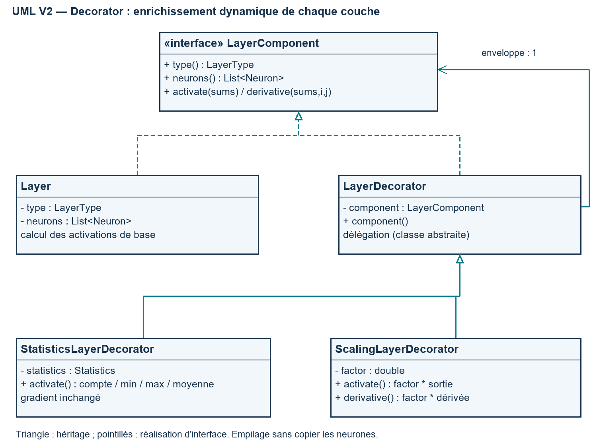

# Examen V2 — Réseau de neurones, Design Patterns et AOP

Java 21 • AspectJ • Conception orientée objet

## Synthèse

Ce projet répond au PDF « Examen Design Pattern V2 », filière GLSID, fourni le 27 novembre 2026 : construire un réseau de neurones extensible, gérer son cycle de vie et séparer les préoccupations transversales des calculs. Cette V2 intègre un biais par neurone et l'enrichissement dynamique des couches. Elle comprend un modèle autonome, une application tissée par AspectJ, des démonstrations et 53 tests automatisés.

Les cinq patterns demandés sont Strategy, Adapter, State, Observer et Decorator. Builder et une Simple Factory complètent la conception. L'apprentissage est effectif : les poids ET les biais sont mis à jour par rétropropagation. Seuls les poids sont projetés dans l'intervalle imposé [0,1] ; les biais sont des réels finis.

## Lecture du rapport

- Pages de conception : hypothèses, structure du réseau et contrats des patterns.
- Pages d'implémentation : apprentissage, états, sécurité et journalisation.
- Extraits Java : activations, adaptation, décorateurs, biais, aspects et tests.
- Validation : tests, résultats reproductibles, limites et améliorations.
- Le code complet, les tests, les POM et les commandes figurent dans le ZIP associé.

## Organisation des livrables

`network-core` contient le modèle et les tests numériques, sans dépendance à Spring. `network-aop` ajoute les aspects et tisse les classes du premier module à la compilation. Les deux modules partagent le package racine `chaimae.net`.

Le module non tissé sert à étudier les patterns séparément. Ses annotations de sécurité ne suffisent pas à sécuriser une exécution : la démonstration sécurisée doit utiliser les classes de `network-aop`.

<!-- pagebreak -->

## 1. Énoncé et hypothèses

Un réseau contient une couche d'entrée, zéro ou plusieurs couches cachées et une couche de sortie. Une couche contient au moins un neurone. Une connexion relie un neurone source à un neurone destination et possède un poids fini compris entre 0 et 1. La figure 3–5–2 est reproduite : 3 × 5 + 5 × 2 = 25 connexions.

### Ambiguïtés résolues explicitement

- La formule imprimée de la sigmoïde présente un signe erroné au dénominateur. La formule retenue est `sigmoid(x) = 1 / (1 + exp(-x))`, définie en zéro et bornée entre 0 et 1.
- Softmax n'est pas une fonction scalaire indépendante : chaque sortie dépend de toutes les sommes de sa couche. La stratégie reçoit donc un vecteur et un indice.
- Les états cohérents sont Construction, Training et Trained. Le texte mélange les termes arrêt/exécution et les noms train/fit ; `fit` est ici un alias de `train`, et non une transition sans calcul.
- `predict` n'est autorisé qu'après un apprentissage réussi. Une reconfiguration d'un réseau entraîné le ramène à Construction.

### Périmètre du modèle

Le réseau est dense et feed-forward, avec biais. Les connexions ne relient que des couches consécutives. Tous les neurones possèdent un champ bias initialisé à zéro ; ceux de l'entrée restent fixés à zéro, conformément au rôle conventionnel de transmission des entrées. La fonction de base de cette couche est Identity ; elle aussi peut recevoir des décorateurs. Les biais des couches cachées et de sortie sont configurables et entraînés.

Les couches suivantes peuvent porter des activations différentes par neurone, sauf Softmax qui doit couvrir toute sa couche pour conserver sa normalisation. Les collections exposées sont des copies non modifiables ; les tableaux des échantillons sont copiés à la construction et à la lecture. Les mutations des poids, biais, activations et décorations passent par le réseau.

### Correspondance avec les questions

- a : Strategy ; b : Adapter vers l'interface historique `LegacyActivation`.
- c : State ; d : Observer et statistiques du tableau de bord.
- e : Decorator, statistiques et mise à l'échelle composables sur les couches.
- f : aspect de journalisation ; g : aspect de contrôle des rôles.
- Questions 1 à 4 : diagrammes, code Java, tests, PDF et améliorations Builder/Simple Factory.

<!-- pagebreak -->

## 2. Modélisation et diagrammes de classes


Le réseau référence ses couches à travers `LayerComponent` et possède ses connexions. La classe concrète `Layer` possède les neurones ; ses décorateurs exposent ces mêmes objets sans les dupliquer. Chaque connexion référence exactement une source et une destination.

La composition décrit un réseau valide prêt à l'apprentissage ; pendant sa construction incrémentale, la liste des couches peut encore être vide. Les stratégies d'activation sont des objets associés et peuvent être partagés lorsqu'elles sont sans état.

<!-- pagebreak -->

## 2.1. Cycle de vie et observation


L'échec d'un apprentissage restaure les poids, les biais et l'état de départ : Construction au premier essai, Trained lors d'un réentraînement. Le tableau de bord compte les entrées observées dans chaque état, pas les epochs. Les statistiques des décorateurs comptent quant à elles les évaluations de couche et restent un historique d'observation, non annulé lors d'un échec.

<!-- pagebreak -->

## 2.2. Décoration des couches — exigence e



`Layer` et `LayerDecorator` implémentent le même contrat `LayerComponent`. Un décorateur enveloppe exactement un composant ; il peut lui-même être enveloppé. Cela évite une sous-classe par combinaison de fonctionnalités et préserve la topologie.

`StatisticsLayerDecorator` compte les évaluations réussies et calcule minimum, maximum et moyenne de la dernière sortie. `ScalingLayerDecorator` multiplie les sorties et leurs dérivées par un facteur positif et fini. Ses effets sont donc pris en compte pendant l'apprentissage.

`decorateLayer` empile une fonctionnalité et `undecorateLayer` retire l'enveloppe extérieure. Ces appels sont autorisés en Construction ou Trained, mais refusés pendant Training. Toute modification ramène prudemment un modèle Trained à Construction, même s'il s'agit seulement d'une observation.

La mise à l'échelle non unitaire est refusée sur Softmax pour ne pas détruire la somme de probabilités égale à 1. Le changement ultérieur d'activation est contrôlé lui aussi. Les décorateurs personnalisés doivent préserver dimensions, neurones, type et contrat de dérivée.

<!-- pagebreak -->

## 3. Justification des design patterns

### Strategy — rendre l'activation interchangeable

`ActivationFunction` définit `activate(double[] sums, int index)` et `derivative(double[] sums, int outputIndex, int inputIndex)`. `Identity`, `Sigmoid` et `Softmax` implémentent ce contrat. Chaque `Neuron` conserve une stratégie modifiable par `NeuralNetwork.setActivation`.

Pour Identity et Sigmoid, les dérivées croisées sont nulles. Softmax fournit une Jacobienne complète : `d y_i / d z_j = y_i * (delta_ij - y_j)`. Une simple dérivée scalaire aurait produit un apprentissage incorrect pour cette activation.

### Adapter — réutiliser une API existante

`AncienneFonctionTanh` implémente l'interface scalaire `LegacyActivation`, avec `calculer` et `derivee`, différente du contrat du réseau. `LegacyActivationAdapter` accepte cette interface et convertit ses opérations vers le contrat vectoriel. Le test utilise aussi une autre implémentation historique : l'adaptateur ne dépend pas de la classe Tanh concrète.

### State — exprimer les opérations autorisées

`NetworkState` est réalisé par `ConstructionState`, `TrainingState` et `TrainedState`. Les contrôles `requireConfiguration`, `requireTraining` et `requirePrediction` sont délégués à l'état courant. Cela évite de disperser des comparaisons d'enum dans les méthodes métier. Le réseau reste responsable du déroulement de l'apprentissage et de la notification des transitions.

Construction autorise la configuration et le lancement d'un apprentissage. Training refuse une configuration, une prédiction ou un apprentissage réentrant. Trained autorise la prédiction et le réentraînement ; une configuration valide invalide le statut appris.

### Observer — découpler le tableau de bord

`NetworkObserver.onStateChange(StateChange)` reçoit l'ancien état, le nouveau et la raison. Le réseau gère l'abonnement et le désabonnement. `Dashboard` fournit un historique et des statistiques sans interface graphique. Les observateurs sont notifiés de façon synchrone sur une copie de la liste des abonnés.

Une `RuntimeException` d'observateur est isolée et son type enregistré dans `observerFailures`. Les autres observateurs continuent de recevoir l'événement ; une erreur fatale n'est pas couverte par cette garantie.

### Builder et Simple Factory — faciliter l'assemblage

`NetworkBuilder` assemble une topologie avec une API fluide, fixe une graine reproductible et déclenche le câblage complet. `ActivationFactory` centralise la création des quatre types d'activation. Il s'agit d'une Simple Factory, pas du pattern GoF Factory Method fondé sur la redéfinition par héritage.

<!-- pagebreak -->

## 4. Implémentation et apprentissage

### Propagation et calcul des gradients

Pour un neurone j, la somme est `z_j = sum_i(w_ij * a_i) + b_j`. La couche applique ensuite les activations et les éventuels décorateurs. La perte choisie est la demi-somme des erreurs quadratiques, moyennée sur les échantillons, sans division supplémentaire par le nombre de sorties.

L'entraînement parcourt les échantillons dans un ordre déterministe pendant le nombre d'epochs demandé. À chaque échantillon, il calcule les sorties, le gradient de la perte puis les deltas de la dernière couche vers la première couche cachée. Tous les deltas utilisent les anciens poids avant toute mutation.

```text
pour chaque epoch :
  pour chaque exemple :
    propager les activations vers la sortie
    calculer les deltas par retropropagation
    pour chaque connexion i -> j :
      gradient = activation_i * delta_j
      poids = max(0, min(1, poids - taux * gradient))
    pour chaque neurone hors entree :
      biais = biais - taux * delta
```

Le calcul est une SGD avec projection, et non un simple changement d'état. La projection respecte la contrainte [0,1] mais peut empêcher un optimum qui exigerait des poids négatifs ou supérieurs à 1. Aucune convergence universelle n'est annoncée.

### Stabilité et reprise sur erreur

La sigmoïde utilise deux branches pour éviter une exponentielle trop grande. Softmax soustrait le maximum du vecteur avant exponentiation, sans changer les probabilités. Le modèle refuse les entrées non finies et détecte un résultat numérique non fini.

Les données et options sont validées avant Training. Un instantané des poids, biais et état est conservé. Une exception d'exécution restaure ces paramètres, notifie le retour et est propagée. Le gradient d'un biais est le delta de son neurone, sans facteur d'entrée. Les dérivées des décorateurs sont incluses via `layer.derivative`.

### Exemple d'utilisation

```java
var network = new NetworkBuilder().input(3)
    .hidden(5, Type.SIGMOID)
    .output(2, Type.SOFTMAX).seed(42).build();
network.setBias(1, 0, -0.2);
network.decorateLayer(1, layer -> new ScalingLayerDecorator(layer, 1.1));
network.decorateLayer(1, StatisticsLayerDecorator::new);
network.fit(samples, new TrainingOptions(10, 0.05));
double[] output = network.predict(input);
```

En mode tissé, l'utilisateur doit être authentifié et disposer des droits nécessaires avant la construction et les appels. Le code ci-dessus illustre le modèle ; les listes d'exemples et le scénario complet sont fournis dans les démonstrations.

<!-- pagebreak -->

## 4.1. Code Java — Strategy et Adapter

Extraits des contrats réellement compilés. L'interface vectorielle permet une dérivée croisée pour Softmax ; l'API historique reste scalaire.

```java
public interface ActivationFunction {
    double activate(double[] sums, int index);
    double derivative(double[] sums, int outputIndex, int inputIndex);
}

public interface LegacyActivation {
    double calculer(double valeur);
    double derivee(double valeur);
}

public final class LegacyActivationAdapter implements ActivationFunction {
    private final LegacyActivation ancienne;

    public LegacyActivationAdapter(LegacyActivation ancienne) {
        this.ancienne = Objects.requireNonNull(ancienne);
    }

    @Override
    public double activate(double[] sums, int index) {
        return ancienne.calculer(sums[index]);
    }

    @Override
    public double derivative(double[] sums, int outputIndex, int inputIndex) {
        return outputIndex == inputIndex ? ancienne.derivee(sums[outputIndex]) : 0;
    }
}
```

`Sigmoid` utilise deux branches stables numériquement. Softmax soustrait le maximum avant exponentiation, puis calcule `exp(z_i-max) / sum(exp(z_k-max))`. Sa Jacobienne est `y_i * (delta_ij - y_j)`.

Les classes complètes, imports et tests sont fournis dans `network-core/src`. Aucun fragment de ce rapport ne remplace les sources compilables du ZIP.

<!-- pagebreak -->

## 4.2. Code Java — Decorator et biais

Le contrat commun permet de substituer un décorateur à une couche de base :

```java
public interface LayerComponent {
    LayerType type();
    List<Neuron> neurons();
    double[] activate(double[] sums);
    double derivative(double[] sums, int outputIndex, int inputIndex);
}
```

Extraits de `ScalingLayerDecorator`, qui hérite de la délégation de `LayerDecorator`. Le constructeur valide le facteur et la compatibilité avec Softmax ; `checked` refuse un résultat non fini.

```java
@Override
public double[] activate(double[] sums) {
    double[] output = super.activate(sums);
    for (int i = 0; i < output.length; i++) {
        output[i] = checked(output[i] * factor);
    }
    return output;
}

@Override
public double derivative(double[] sums, int outputIndex, int inputIndex) {
    return checked(factor * super.derivative(sums, outputIndex, inputIndex));
}
```

L'apprentissage utilise tous les deltas calculés avant de mettre à jour les poids puis les biais. La mise à jour du biais dans `NeuralNetwork.update` est :

```java
for (int layerIndex = 1; layerIndex < layers.size(); layerIndex++) {
    for (Neuron neuron : layers.get(layerIndex).neurons()) {
        neuron.setBias(finite(neuron.bias()
            - learningRate * deltas[layerIndex][neuron.index()]));
    }
}
```

Un décorateur purement observateur délègue la dérivée inchangée. Un décorateur qui transforme les sorties doit appliquer la règle de dérivation correspondante. Une implémentation « affichage seulement » de la mise à l'échelle serait incorrecte.

<!-- pagebreak -->

## 5. Journalisation et sécurité

### Tissage réel avec AspectJ

Le compilateur AJC tisse les classes de `network-core` dans `network-aop` grâce à `weaveDependencies`. Aucun proxy Spring ni agent JVM n'est nécessaire à l'exécution. L'interception des exécutions de méthodes permet aussi de couvrir les méthodes privées et les appels internes.

`LoggingAspect` intercepte les méthodes sous `chaimae.net`, en excluant l'infrastructure des aspects et les tests. Son advice `@Around` écrit un début, appelle `proceed`, puis écrit une fin dans un bloc `finally`. Les signatures, le statut et la durée en microsecondes sont conservés ; les arguments, valeurs de retour, mots de passe et messages d'exception ne sont pas enregistrés.

Les traces sont émises au niveau JUL FINE. La démonstration sécurisée charge la configuration avant son `main` et utilise trois fichiers tournants de 1 Mo. L'ordre déclaré place le logging à l'extérieur de la sécurité, afin de tracer aussi les refus d'accès.

### Authentification et autorisation

`AuthenticationService` conserve des comptes locaux avec un sel aléatoire de 16 octets et un hash PBKDF2-HMAC-SHA256, 210 000 itérations, 256 bits. La comparaison des hashes utilise `MessageDigest.isEqual`. Un échec d'authentification efface une éventuelle identité précédente.

`SecurityContext` associe l'identité au thread courant et la retire par `logout`. `SecurityAspect` vérifie l'annotation `@RequiresRole` à l'exécution. Les méthodes de lecture demandent READ, les mutations CONFIGURE, les méthodes `train` et `fit` TRAIN, et `predict` PREDICT. Un test vérifie que chaque méthode publique déclarée du réseau possède une annotation.

La démonstration crée des comptes fictifs `admin` et `lecteur`, mot de passe `Demo-2027!`. L'administrateur a tous les rôles ; le lecteur ne possède que READ. L'inscription est une opération de bootstrap de confiance, pas un service public d'auto-attribution des rôles.

### Garanties et limites

Le tissage protège les points d'entrée du réseau, pas une JVM contre du code hostile. Les références de modèle ne constituent pas une frontière de sécurité pour un attaquant pouvant exécuter du Java dans le même processus. La version non tissée contourne volontairement les aspects et doit rester un outil pédagogique.

Il n'y a ni stockage persistant, ni limitation des tentatives, ni gestion de sessions distantes. L'usage de PBKDF2 améliore le stockage local, mais ne transforme pas cette démonstration en système d'identité de production.

<!-- pagebreak -->

## 5.1. Code Java — aspects

L'advice de journalisation possède la priorité extérieure à la sécurité. Extrait de `LoggingAspect`, avec le même pointcut que les sources :

```java
@Around("execution(* chaimae.net..*(..)) && !within(chaimae.net.aop..*)"
        + " && !within(chaimae.net.tests..*)")
public Object log(ProceedingJoinPoint point) throws Throwable {
    String signature = point.getSignature().toLongString();
    long start = System.nanoTime();
    String status = "OK";
    LOGGER.fine("DEBUT " + signature);
    try {
        return point.proceed();
    } catch (Throwable error) {
        status = "ERREUR:" + error.getClass().getSimpleName();
        throw error;
    } finally {
        LOGGER.fine("FIN " + signature + " statut=" + status
                + " duree_us=" + (System.nanoTime() - start) / 1_000);
    }
}
```

Le rôle requis est porté par l'annotation, non codé dans la méthode métier :

```java
@Before("execution(@chaimae.net.annotation.RequiresRole * *(..))"
        + " && @annotation(requirement)")
public void verify(RequiresRole requirement) {
    User user = SecurityContext.current();
    if (user == null) {
        throw new SecurityException("Authentification requise.");
    }
    if (!user.roles().contains(requirement.value())) {
        throw new SecurityException("Role requis : " + requirement.value());
    }
}
```

Les classes sont annotées `@Aspect`. La journalisation concerne les méthodes applicatives, y compris privées ; constructeurs, infrastructure d'aspects et méthodes de bibliothèques Java ne sont pas inclus dans ce périmètre. `setBias`, `decorateLayer` et `undecorateLayer` demandent CONFIGURE, comme les autres mutations.

<!-- pagebreak -->

## 6. Tests et résultats

### Campagne automatisée

La commande `.\mvnw.cmd clean verify` compile et teste les deux modules. Le projet cible Java 21 et a été vérifié localement avec Java 23.0.2. Les versions sont fixées dans les POM et le Maven Wrapper utilise Maven 3.9.9.

- `ActivationTest` : 8 cas, sigmoïde, Identity, interface historique, normalisation et stabilité Softmax, Jacobienne comparée aux différences finies et fabrique.
- `NetworkTest` : 16 cas, dont les paramètres des poids invalides ; topologie 3–5–2, sommes pondérées, apprentissage, états, statistiques du tableau de bord, copies défensives et restauration sur panne.
- `BiasTest` : 9 cas, propagation, apprentissage affine, validation, invalidation, interdiction pendant Training et restauration des biais.
- `LayerDecoratorTest` : 10 cas, empilage/retrait, décoration de l'entrée, statistiques, gradients de mise à l'échelle, différences finies, états, erreurs et Softmax.
- `AspectsTest` : 10 cas, véritable code tissé, anonymat, droits, isolation des threads, logging et protection des nouvelles opérations V2.
- Total : **53 tests, 0 échec, 0 erreur, 0 ignoré**. `docs/resultats-tests.json` est extrait des rapports Surefire au moment de générer les livrables.

Ces tests sont des validations ciblées, pas une preuve de correction pour toute topologie ou tout jeu de données. Aucun pourcentage de couverture non mesuré n'est annoncé.

### Résultats des démonstrations

Pour la figure 3–5–2, graine 42, couche cachée mise à l'échelle par 1.1 puis décorée de statistiques, une entrée `[0.2, 0.4, 0.6]` et dix epochs donnent `[0.8057299065, 0.1942700935]`, de somme 1. Le compteur de couche vaut 13 : pertes initiale/finale, dix mises à jour et une prédiction.

Un second réseau affine 1–1 apprend `y = 0.6*x - 0.4` à partir des exemples `0 -> -0.4`, `1 -> 0.2` et `2 -> 0.8`. Après 1 000 epochs, taux 0.05 et graine 7 :

```text
Perte initiale : 0.14651481648686074
Perte finale   : 8.474091755303838E-32
Poids appris : 0.5999999999999995
Biais appris : -0.39999999999999947
Prediction [1.5] : 0.4999999999999998
```

L'erreur finale porte sur le jeu pédagogique d'apprentissage ; elle ne mesure pas une généralisation statistique. La prédiction supplémentaire est cohérente avec la fonction attendue.

La démonstration sécurisée refuse l'anonyme, autorise la prédiction de l'administrateur, permet au lecteur de consulter l'état Trained et refuse sa prédiction avec le rôle PREDICT manquant.

### Reproduction et remise

Après `.\mvnw.cmd install`, lancer les classes `chaimae.net.demo.DemoModele` et `chaimae.net.demo.DemoSecurisee` avec le plugin exec, comme indiqué dans le README. `python tools/build_deliverables.py` régénère les figures, ce PDF, le bilan de tests et le ZIP à partir des fichiers locaux.

<!-- pagebreak -->

## 6.1. Code de test et vérification analytique

Extrait du test `BiasTest` : une valeur de biais non nulle doit effectivement intervenir dans la propagation, pas seulement apparaître dans le diagramme.

```java
@Test
void propagationAjouteLeBiaisALaSommePonderee() {
    var network = network();
    network.setWeight(0, 0.25);
    network.setBias(1, 0, -0.3);
    network.fit(List.of(new TrainingSample(
        new double[]{2}, new double[]{0.2})), new TrainingOptions(1, 0.1));
    assertEquals(0.2, network.predict(new double[]{2})[0], 1e-12);
}
```

Le réseau auxiliaire `network()` est un réseau Identity 1–1. Comme `0.25*2-0.3 = 0.2`, le gradient est nul à l'arrondi près et un epoch ne change pas le résultat attendu.

### Vérifier la chaîne de dérivation du décorateur

`LayerDecoratorTest` utilise un réseau 1–1–1 Identity, entrée 0.7, cible 0.3, poids 0.4 et 0.6, biais 0.1 et -0.2. La couche cachée est multipliée par 3.

```text
a_cachee = 3 * (0.4*0.7 + 0.1) = 1.14
y        = 0.6*1.14 - 0.2       = 0.484
erreur   = y - 0.3              = 0.184
dL/dw1   = 0.184 * 0.6 * 3 * 0.7
dL/dw2   = 0.184 * 1.14
dL/db1   = 0.184 * 0.6 * 3
dL/db2   = 0.184
```

Après un pas de taux 0.01, chaque poids et biais est comparé à sa valeur analytique avec une tolérance de 1e-12. Un autre test compare la dérivée d'une couche Sigmoid décorée aux différences finies. Le test de panne déclenche une exception après une première mise à jour et vérifie la restauration des poids ET du biais.

Les tests d'aspects ne se contentent pas d'appeler les advices : ils invoquent les classes réellement tissées et vérifient que le lecteur ne peut pas configurer un biais ni ajouter/retirer un décorateur.

<!-- pagebreak -->

## 7. Améliorations, limites et conclusion

### Extensions pertinentes

- Strategy pour un optimiseur : extraire la SGD de `NeuralNetwork` permettrait de comparer SGD, momentum et Adam sans réécrire le modèle. La projection [0,1] resterait une politique explicite.
- Memento pour les checkpoints : l'instantané des poids et biais pourrait devenir un objet de sauvegarde versionné et persistant, utile pour reprendre ou annuler un apprentissage.
- Command pour l'orchestration : représenter configuration, apprentissage et prédiction comme commandes faciliterait une file de tâches et l'historisation.
- Strategy pour la perte : ajouter l'entropie croisée sans coupler le choix de la fonction de coût à la topologie.

Ces extensions sont proposées, pas présentées comme déjà implémentées. Builder et Simple Factory sont les deux ajouts effectifs à la solution demandée.

### Limites assumées

Le réseau possède bien les biais demandés en V2, mais pas de connexions récurrentes. Les poids positifs bornés restreignent sa capacité d'expression : aucune résolution de XOR n'est revendiquée. La perte quadratique a été choisie pour sa simplicité ; l'entropie croisée serait plus habituelle pour une classification avec Softmax.

Le traitement est synchrone et non thread-safe. Training est observable grâce aux notifications ; il n'y a ni pause/stop ni interface graphique. Les activations et décorateurs personnalisés doivent respecter leur contrat de dérivée. Les fonctionnalités proposées ne comprennent pas de dropout stochastique, qui exigerait un contexte d'apprentissage et un masque mémorisé.

Le calcul Softmax est volontairement lisible plutôt qu'optimisé : ses probabilités sont recalculées pour les éléments de Jacobienne. Une version destinée à de grands réseaux mémoriserait les sorties intermédiaires et exploiterait des opérations matricielles.

### Conclusion

La solution sépare calcul, variations d'activation, contrôle du cycle de vie, observation et aspects techniques. Les tests vérifient à la fois les comportements des patterns et l'effet réel du tissage. L'apprentissage déterministe et la restauration sur panne rendent les résultats vérifiables, dans un périmètre pédagogique clairement délimité.

### Sources

- « Examen Design Pattern V2.pdf », ENSET Mohammedia, GLSID, durée 3 h, 2 pages, fourni par l'utilisateur.
- Documentation AspectJ : https://eclipse.dev/aspectj/doc/
- Documentation Java 21 : https://docs.oracle.com/en/java/javase/21/
- Documentation JUnit 5 : https://docs.junit.org/5.11.4/user-guide/

Cette version utilise le package chaimae.net et la branche examen-v2 du dépôt Neural-Network-design-patterns. La version antérieure sur main et l'activité AOP ne sont pas remplacées. Le ZIP contient le code compilable complet, les tests, le rapport et les outils de génération.
