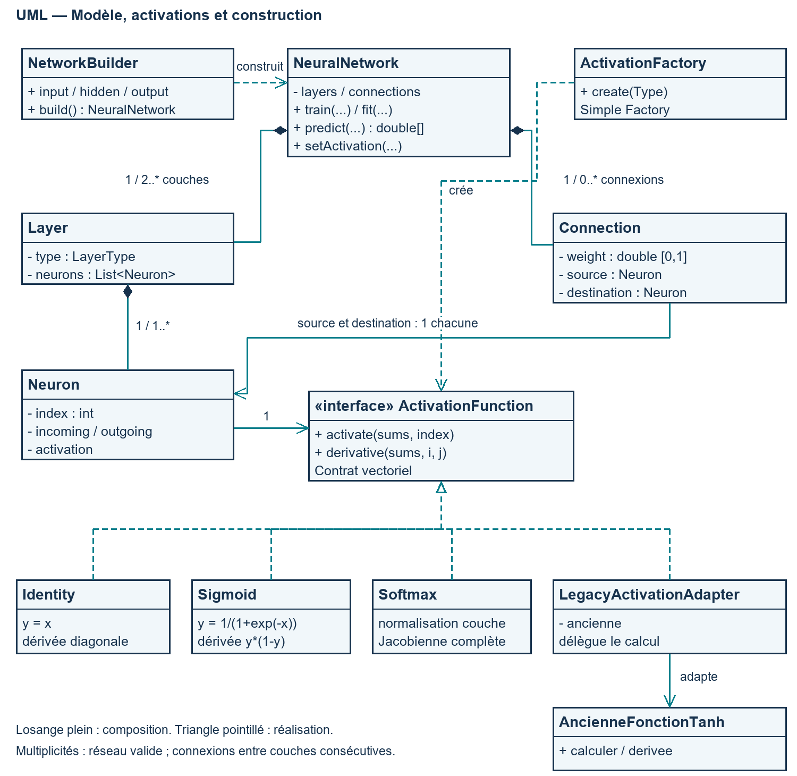
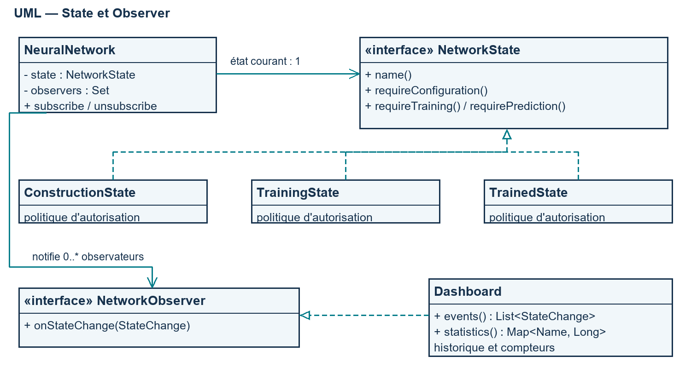
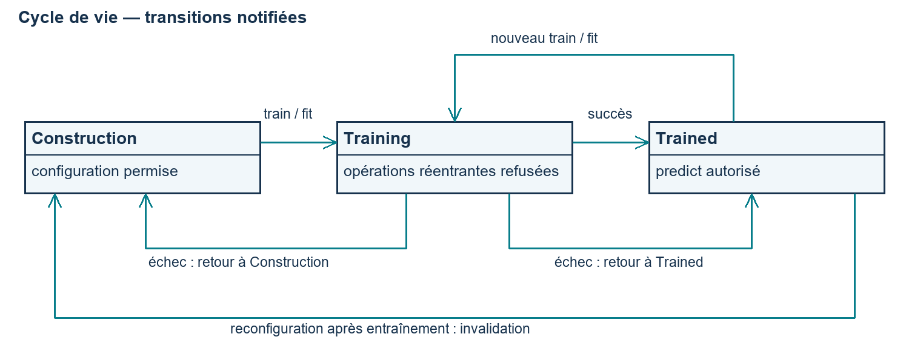

# Examen — Réseau de neurones, Design Patterns et AOP

Java 21 • AspectJ • Conception orientée objet

## Synthèse

Ce projet répond à l'examen transmis sous forme de deux captures : construire un réseau de neurones extensible, gérer son cycle de vie et ajouter des préoccupations transversales sans les mélanger aux calculs. L'implémentation comprend un modèle autonome, une application tissée par AspectJ, des démonstrations et 31 tests automatisés.

Les quatre patterns demandés sont Strategy pour les activations, Adapter pour une API historique, State pour le cycle de vie et Observer pour le tableau de bord. Builder et une Simple Factory complètent la conception. L'apprentissage est effectif : les poids sont mis à jour par descente de gradient et rétropropagation, puis projetés dans l'intervalle imposé [0,1].

## Lecture du rapport

- Pages de conception : hypothèses, structure du réseau et contrats des patterns.
- Pages d'implémentation : apprentissage, états, sécurité et journalisation.
- Validation : tests, résultats reproductibles, limites et améliorations.
- Le code complet, les tests, les POM et les commandes figurent dans le ZIP associé.

## Organisation des livrables

`network-core` contient le modèle et les tests numériques, sans dépendance à Spring. `network-aop` ajoute les aspects et tisse les classes du premier module à la compilation. Les deux modules partagent le package racine `fr.enset.nn`.

Le module non tissé sert à étudier les patterns séparément. Ses annotations de sécurité ne suffisent pas à sécuriser une exécution : la démonstration sécurisée doit utiliser les classes de `network-aop`.

<!-- pagebreak -->

## 1. Énoncé et hypothèses

Un réseau contient une couche d'entrée, zéro ou plusieurs couches cachées et une couche de sortie. Une couche contient au moins un neurone. Une connexion relie un neurone source à un neurone destination et possède un poids fini compris entre 0 et 1. La figure 3–5–2 est reproduite : 3 × 5 + 5 × 2 = 25 connexions.

### Ambiguïtés résolues explicitement

- La formule imprimée de la sigmoïde présente un signe erroné au dénominateur. La formule retenue est `sigmoid(x) = 1 / (1 + exp(-x))`, définie en zéro et bornée entre 0 et 1.
- Softmax n'est pas une fonction scalaire indépendante : chaque sortie dépend de toutes les sommes de sa couche. La stratégie reçoit donc un vecteur et un indice.
- Les états cohérents sont Construction, Training et Trained. Le texte mélange les termes arrêt/exécution et les noms train/fit ; `fit` est ici un alias de `train`, et non une transition sans calcul.
- `predict` n'est autorisé qu'après un apprentissage réussi. Une reconfiguration d'un réseau entraîné le ramène à Construction.

### Périmètre du modèle

Le réseau est dense, feed-forward et sans biais. Les connexions ne relient que des couches consécutives. La couche d'entrée transmet ses valeurs sans transformation. Les couches suivantes peuvent porter des activations différentes par neurone ; en revanche, l'utilisation de Softmax impose cette activation à toute la couche pour conserver sa normalisation.

Les méthodes publiques du réseau contrôlent l'ordre des couches, les dimensions, les valeurs finies et les droits lorsqu'elles sont tissées. Les collections exposées sont des copies non modifiables ; les tableaux des échantillons sont copiés à la construction et à la lecture. Les mutations des poids et activations passent par le réseau.

### Correspondance avec les questions

- Modélisation : diagrammes de classes et d'états, pages suivantes.
- Implémentation : modèle, activations, apprentissage et aspects.
- Application de test : `DemoModele` et `DemoSecurisee`.
- Autres patterns : Builder et Simple Factory, avec pistes d'extension justifiées.
- Remise : rapport PDF et ZIP comprenant sources, tests, documentation et scripts.

<!-- pagebreak -->

## 2. Modélisation et diagrammes de classes



Le réseau possède ses couches et connexions ; chaque couche possède ses neurones. Une connexion référence exactement une source et une destination. Les listes entrantes/sortantes d'un neurone permettent la propagation et la rétropropagation, sans transférer au neurone la propriété des connexions.

La composition décrit un réseau valide prêt à l'apprentissage ; pendant sa construction incrémentale, la liste des couches peut encore être vide. Les stratégies d'activation sont des objets associés et peuvent être partagés lorsqu'elles sont sans état.

<!-- pagebreak -->

## 2.1. Cycle de vie et observation





L'échec d'un apprentissage restaure les poids et l'état de départ : Construction lors du premier essai, Trained lors d'un réentraînement. Le tableau de bord conserve les transitions observées et compte les entrées dans chaque état ; ces compteurs ne représentent ni le nombre d'epochs ni une mesure de précision.

<!-- pagebreak -->

## 3. Justification des design patterns

### Strategy — rendre l'activation interchangeable

`ActivationFunction` définit `activate(double[] sums, int index)` et `derivative(double[] sums, int outputIndex, int inputIndex)`. `Identity`, `Sigmoid` et `Softmax` implémentent ce contrat. Chaque `Neuron` conserve une stratégie modifiable par `NeuralNetwork.setActivation`.

Pour Identity et Sigmoid, les dérivées croisées sont nulles. Softmax fournit une Jacobienne complète : `d y_i / d z_j = y_i * (delta_ij - y_j)`. Une simple dérivée scalaire aurait produit un apprentissage incorrect pour cette activation.

### Adapter — réutiliser une API existante

`AncienneFonctionTanh` expose `calculer` et `derivee`, sans implémenter le contrat du réseau. `LegacyActivationAdapter` délègue à cette API et convertit ses opérations scalaires vers le contrat vectoriel. La classe historique ne doit pas être modifiée pour être intégrée.

### State — exprimer les opérations autorisées

`NetworkState` est réalisé par `ConstructionState`, `TrainingState` et `TrainedState`. Les contrôles `requireConfiguration`, `requireTraining` et `requirePrediction` sont délégués à l'état courant. Cela évite de disperser des comparaisons d'enum dans les méthodes métier. Le réseau reste responsable du déroulement de l'apprentissage et de la notification des transitions.

Construction autorise la configuration et le lancement d'un apprentissage. Training refuse une configuration, une prédiction ou un apprentissage réentrant. Trained autorise la prédiction et le réentraînement ; une configuration valide invalide le statut appris.

### Observer — découpler le tableau de bord

`NetworkObserver.onStateChange(StateChange)` reçoit l'ancien état, le nouveau et la raison. Le réseau gère l'abonnement et le désabonnement. `Dashboard` fournit un historique et des statistiques sans interface graphique. Les observateurs sont notifiés de façon synchrone sur une copie de la liste des abonnés.

Une `RuntimeException` d'observateur est isolée et son type enregistré dans `observerFailures`. Les autres observateurs continuent de recevoir l'événement ; une erreur fatale n'est pas couverte par cette garantie.

### Builder et Simple Factory — faciliter l'assemblage

`NetworkBuilder` assemble une topologie avec une API fluide, fixe une graine reproductible et déclenche le câblage complet. `ActivationFactory` centralise la création des quatre types d'activation. Il s'agit d'une Simple Factory, pas du pattern GoF Factory Method fondé sur la redéfinition par héritage.

<!-- pagebreak -->

## 4. Implémentation et apprentissage

### Propagation et calcul des gradients

Pour un neurone j, la somme est `z_j = sum_i(w_ij * a_i)` et la sortie est l'activation de cette somme, ou du vecteur de sommes pour Softmax. La perte choisie est la demi-somme des erreurs quadratiques, moyennée sur les échantillons, sans division supplémentaire par le nombre de sorties.

L'entraînement parcourt les échantillons dans un ordre déterministe pendant le nombre d'epochs demandé. À chaque échantillon, il calcule les sorties, le gradient de la perte puis les deltas de la dernière couche vers la première couche cachée. Tous les deltas utilisent les anciens poids avant toute mutation.

```text
pour chaque epoch :
  pour chaque exemple :
    propager les activations vers la sortie
    calculer les deltas par retropropagation
    pour chaque connexion i -> j :
      gradient = activation_i * delta_j
      poids = max(0, min(1, poids - taux * gradient))
```

Le calcul est une SGD avec projection, et non un simple changement d'état. La projection respecte la contrainte [0,1] mais peut empêcher un optimum qui exigerait des poids négatifs ou supérieurs à 1. Aucune convergence universelle n'est annoncée.

### Stabilité et reprise sur erreur

La sigmoïde utilise deux branches pour éviter une exponentielle trop grande. Softmax soustrait le maximum du vecteur avant exponentiation, sans changer les probabilités. Le modèle refuse les entrées non finies et détecte un résultat numérique non fini.

Les données et options sont validées avant la transition vers Training. Un instantané des poids et de l'état est ensuite conservé. Une exception d'exécution pendant l'apprentissage restaure ces valeurs, notifie le retour à l'état de départ et est propagée à l'appelant.

### Exemple d'utilisation

```java
var network = new NetworkBuilder().input(3)
    .hidden(5, Type.SIGMOID)
    .output(2, Type.SOFTMAX).seed(42).build();
network.fit(samples, new TrainingOptions(10, 0.05));
double[] output = network.predict(input);
```

En mode tissé, l'utilisateur doit être authentifié et disposer des droits nécessaires avant la construction et les appels. Le code ci-dessus illustre le modèle ; les listes d'exemples et le scénario complet sont fournis dans les démonstrations.

<!-- pagebreak -->

## 5. Journalisation et sécurité

### Tissage réel avec AspectJ

Le compilateur AJC tisse les classes de `network-core` dans `network-aop` grâce à `weaveDependencies`. Aucun proxy Spring ni agent JVM n'est nécessaire à l'exécution. L'interception des exécutions de méthodes permet aussi de couvrir les méthodes privées et les appels internes.

`LoggingAspect` intercepte les méthodes sous `fr.enset.nn`, en excluant l'infrastructure des aspects et les tests. Son advice `@Around` écrit un début, appelle `proceed`, puis écrit une fin dans un bloc `finally`. Les signatures, le statut et la durée en microsecondes sont conservés ; les arguments, valeurs de retour, mots de passe et messages d'exception ne sont pas enregistrés.

Les traces sont émises au niveau JUL FINE. La démonstration sécurisée charge la configuration avant son `main` et utilise trois fichiers tournants de 1 Mo. L'ordre déclaré place le logging à l'extérieur de la sécurité, afin de tracer aussi les refus d'accès.

### Authentification et autorisation

`AuthenticationService` conserve des comptes locaux avec un sel aléatoire de 16 octets et un hash PBKDF2-HMAC-SHA256, 210 000 itérations, 256 bits. La comparaison des hashes utilise `MessageDigest.isEqual`. Un échec d'authentification efface une éventuelle identité précédente.

`SecurityContext` associe l'identité au thread courant et la retire par `logout`. `SecurityAspect` vérifie l'annotation `@RequiresRole` à l'exécution. Les méthodes de lecture demandent READ, les mutations CONFIGURE, les méthodes `train` et `fit` TRAIN, et `predict` PREDICT. Un test vérifie que chaque méthode publique déclarée du réseau possède une annotation.

La démonstration crée des comptes fictifs `admin` et `lecteur`, mot de passe `Demo-2027!`. L'administrateur a tous les rôles ; le lecteur ne possède que READ. L'inscription est une opération de bootstrap de confiance, pas un service public d'auto-attribution des rôles.

### Garanties et limites

Le tissage protège les points d'entrée du réseau, pas une JVM contre du code hostile. Les références de modèle ne constituent pas une frontière de sécurité pour un attaquant pouvant exécuter du Java dans le même processus. La version non tissée contourne volontairement les aspects et doit rester un outil pédagogique.

Il n'y a ni stockage persistant, ni limitation des tentatives, ni gestion de sessions distantes. L'usage de PBKDF2 améliore le stockage local, mais ne transforme pas cette démonstration en système d'identité de production.

<!-- pagebreak -->

## 6. Tests et résultats

### Campagne automatisée

La commande `.\mvnw.cmd clean verify` compile et teste les deux modules. Le projet cible Java 21 et a été vérifié localement avec Java 23.0.2. Les versions sont fixées dans les POM et le Maven Wrapper utilise Maven 3.9.9.

- `ActivationTest` : 7 cas, sigmoïde, Identity, adaptation Tanh, normalisation et stabilité Softmax, Jacobienne comparée aux différences finies et fabrique.
- `NetworkTest` : 16 cas, dont les paramètres des poids invalides ; topologie 3–5–2, sommes pondérées, apprentissage, états, statistiques du tableau de bord, copies défensives et restauration sur panne.
- `AspectsTest` : 8 cas, véritable code tissé, anonymat, droits, mauvais mot de passe, isolation entre threads, logging des méthodes privées et des refus.
- Total : **31 tests, 0 échec, 0 erreur, 0 ignoré**. Le fichier `docs/resultats-tests.json` est extrait des rapports Surefire au moment de générer les livrables.

Ces tests sont des validations ciblées, pas une preuve de correction pour toute topologie ou tout jeu de données. Aucun pourcentage de couverture non mesuré n'est annoncé.

### Résultats des démonstrations

Pour la figure 3–5–2, graine 42, une entrée `[0.2, 0.4, 0.6]` et dix epochs donnent une sortie Softmax `[0.7755427639, 0.2244572361]`, de somme 1.

Un second réseau linéaire 2–1 apprend la relation `y = 0.25*x1 + 0.75*x2` à partir des exemples `[1,0] -> 0.25`, `[0,1] -> 0.75` et `[1,1] -> 1`. Après 200 epochs, taux 0.1 et graine 7 :

```text
Perte initiale : 0.07689102920606851
Perte finale   : 9.617635187876788E-21
Prediction [0.4, 0.8] : 0.6999999999320554
```

L'erreur finale porte sur le jeu pédagogique d'apprentissage ; elle ne mesure pas une généralisation statistique. La prédiction supplémentaire est cohérente avec la fonction attendue.

La démonstration sécurisée refuse l'anonyme, autorise la prédiction de l'administrateur, permet au lecteur de consulter l'état Trained et refuse sa prédiction avec le rôle PREDICT manquant.

### Reproduction et remise

Après `.\mvnw.cmd install`, lancer les classes `fr.enset.nn.demo.DemoModele` et `fr.enset.nn.demo.DemoSecurisee` avec le plugin exec, comme indiqué dans le README. `python tools/build_deliverables.py` régénère les figures, ce PDF, le bilan de tests et le ZIP à partir des fichiers locaux.

<!-- pagebreak -->

## 7. Améliorations, limites et conclusion

### Extensions pertinentes

- Strategy pour un optimiseur : extraire la SGD de `NeuralNetwork` permettrait de comparer SGD, momentum et Adam sans réécrire le modèle. La projection [0,1] resterait une politique explicite.
- Memento pour les checkpoints : l'instantané de poids actuel pourrait devenir un objet de sauvegarde versionné et persistant, utile pour reprendre ou annuler un apprentissage.
- Command pour l'orchestration : représenter configuration, apprentissage et prédiction comme commandes faciliterait une file de tâches et l'historisation.
- Decorator pour des activations complémentaires : possible pour une fonction scalaire, mais à utiliser avec prudence pour Softmax dont les sorties sont couplées.

Ces extensions sont proposées, pas présentées comme déjà implémentées. Builder et Simple Factory sont les deux ajouts effectifs à la solution demandée.

### Limites assumées

Le réseau ne possède ni biais ni connexions récurrentes. Les poids positifs bornés restreignent sa capacité d'expression : aucune résolution de XOR n'est revendiquée. La perte quadratique a été choisie pour sa simplicité ; une entropie croisée serait plus habituelle pour une classification avec Softmax.

Le traitement est synchrone et le modèle n'est pas thread-safe. Training est observable pendant l'appel grâce aux notifications ; il n'existe pas de commande pause/stop ni d'interface graphique. Les activations personnalisées doivent respecter le contrat de dérivée pour obtenir des gradients corrects.

Le calcul Softmax est volontairement lisible plutôt qu'optimisé : ses probabilités sont recalculées pour les éléments de Jacobienne. Une version destinée à de grands réseaux mémoriserait les sorties intermédiaires et exploiterait des opérations matricielles.

### Conclusion

La solution sépare calcul, variations d'activation, contrôle du cycle de vie, observation et aspects techniques. Les tests vérifient à la fois les comportements des patterns et l'effet réel du tissage. L'apprentissage déterministe et la restauration sur panne rendent les résultats vérifiables, dans un périmètre pédagogique clairement délimité.

### Sources

- Énoncé de l'examen fourni par l'utilisateur en deux captures : réseau de neurones, patterns et aspects.
- Documentation AspectJ : https://eclipse.dev/aspectj/doc/
- Documentation Java 21 : https://docs.oracle.com/en/java/javase/21/
- Documentation JUnit 5 : https://docs.junit.org/5.11.4/user-guide/

Les trois vidéos de l'activité AOP sont traitées dans le rapport du premier projet. Ce second projet est une implémentation dédiée au véritable énoncé du réseau de neurones et ne reprend pas l'ancien examen sur les dessins.
